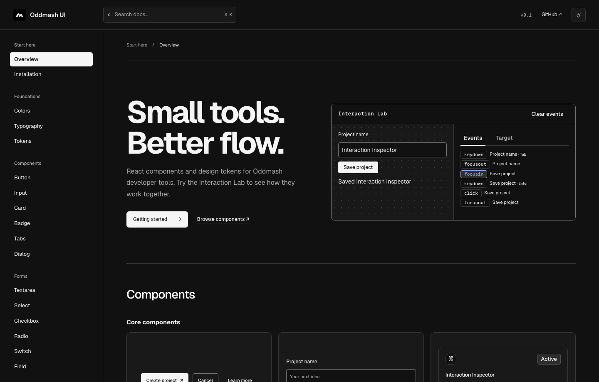

# Oddmash UI

**English** · [한국어](docs/ko/README.md) · [日本語](docs/ja/README.md) · [简体中文](docs/zh-CN/README.md)

Oddmash UI is the shared interface foundation for Oddmash products. It gives small React developer tools a consistent visual language, accessible interaction patterns, and themeable design tokens without deciding the product layout for them.

<picture>
  <source media="(prefers-color-scheme: dark)" srcset="docs/assets/playground-dark.png">
  
</picture>

## What it provides

- Accessible React components for forms, feedback, navigation, overlays, and data display.
- JSON design tokens for color, typography, spacing, radius, shadow, border, and motion.
- Light and dark themes that can be applied to a whole app or a single subtree.
- A documentation site with live examples, API guidance, accessibility notes, and a token explorer.
- An Interaction Lab that shows how the components work together in a developer-tool interface.

## Who it is for

Oddmash UI is for focused tools such as Interaction Inspector: products that need clear controls and dependable behavior but should not each invent a new component system. Product-specific layout, information hierarchy, and branding remain in the product.

## Design principles

- **Consistent by default.** Shared components and semantic tokens make Oddmash tools feel related.
- **Color signals interaction.** Neutral surfaces and controls carry the interface. Blue indicates focus and red indicates errors.
- **Accessible in behavior.** Keyboard interaction, focus handling, reduced motion, and forced colors are part of the component contract.
- **Themeable, not prescriptive.** Products can override semantic tokens without forking the components.
- **Small on purpose.** The system grows from real product needs rather than trying to cover every UI pattern.

## Current scope

Oddmash UI is under active pre-1.0 development. Version 0.4.0 includes 24 component families, including Toast.

[Docs](https://oddmash.github.io/oddmash-ui/) · [npm](https://www.npmjs.com/package/@oddmash/ui) · [GitHub](https://github.com/Oddmash/oddmash-ui) · [Contributor guide](CONTRIBUTING.md) · [MIT License](LICENSE)
