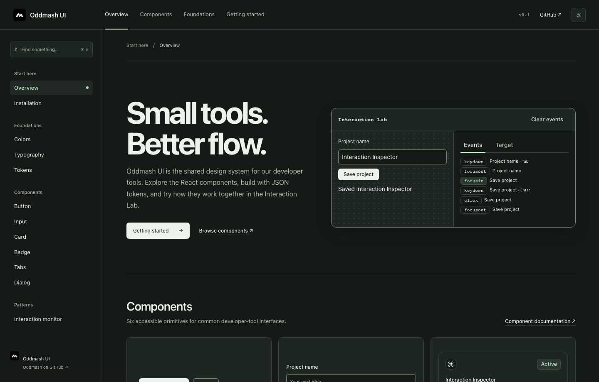

# Oddmash UI

[English](../../README.md) · [한국어](../ko/README.md) · **日本語** · [简体中文](../zh-CN/README.md)

Oddmash UI は、Oddmash 製品で共有するインターフェース基盤です。小規模な React 開発ツールに、一貫したビジュアル言語、アクセシブルな操作パターン、テーマ変更可能なデザイントークンを提供しつつ、製品固有のレイアウトまでは規定しません。

## 提供するもの

- ボタン、入力、カード、バッジ、タブ、ダイアログのアクセシブルな React プリミティブ
- 色、タイポグラフィ、余白、角丸、影、境界線、モーションを定義する JSON デザイントークン
- アプリ全体または一部に適用できるライト・ダークテーマ
- ライブ例、API ガイド、アクセシビリティ情報、トークンエクスプローラーを備えたドキュメントサイト
- コンポーネントを組み合わせた開発者ツールの UI で、フォーカス、キー入力、クリックを確認できる Interaction Lab

## 対象

Interaction Inspector のように、明確な操作と信頼できる挙動が必要でも、製品ごとに新しいコンポーネントシステムを作る必要はない小規模ツールを対象にしています。製品固有のレイアウト、情報設計、ブランド表現は各製品が担います。

## デザイン原則

- **最初から一貫性を。** 共有コンポーネントとセマンティックトークンで Oddmash 製品の統一感を保ちます。
- **挙動もアクセシブルに。** キーボード操作、フォーカス、視差効果の軽減、強制カラーをコンポーネントの契約に含めます。
- **テーマ可能だが押し付けない。** 製品はコンポーネントを複製せず、セマンティックトークンを上書きできます。
- **意図的に小さく。** あらゆる UI を先回りせず、実際の製品ニーズに応じて拡張します。

## 現在の範囲

Oddmash UI は 1.0 前の段階で開発中です。現在は 6 種類のコンポーネントファミリーを提供し、npm にはまだ公開していません。[Oddmash UI ドキュメント](https://oddmash.github.io/oddmash-ui/)で実際の動作を確認できます。

[コントリビューターガイド](../../CONTRIBUTING.md) · [MIT License](../../LICENSE)
