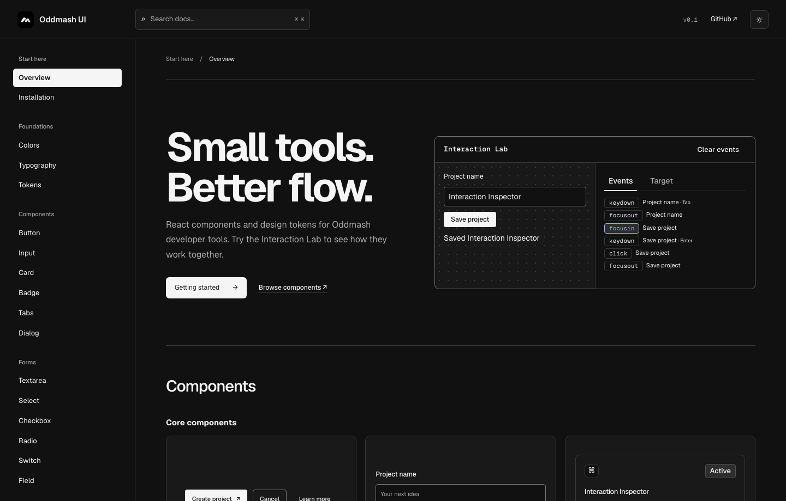

# Oddmash UI

[English](../../README.md) · **한국어** · [日本語](../ja/README.md) · [简体中文](../zh-CN/README.md)

Oddmash UI는 Oddmash 제품이 함께 사용하는 인터페이스 기반입니다. 작은 React 개발 도구에 일관된 시각 언어, 접근 가능한 상호작용 패턴, 테마를 바꿀 수 있는 디자인 토큰을 제공하되 제품의 화면 구성까지 대신 결정하지는 않습니다.

## 무엇을 제공하나요?

- 폼, 상태 표시, 탐색, 오버레이, 데이터 표시에 쓰는 접근 가능한 React 컴포넌트
- 색상, 타이포그래피, 간격, 모서리, 그림자, 테두리, 모션을 정의하는 JSON 디자인 토큰
- 앱 전체 또는 일부 영역에 적용할 수 있는 라이트·다크 테마
- 실시간 예제, API 안내, 접근성 설명, 토큰 탐색기를 갖춘 문서 사이트
- 컴포넌트를 조합한 개발자 도구 UI에서 포커스, 키 입력, 클릭을 직접 확인할 수 있는 Interaction Lab

## 누구를 위한 시스템인가요?

Interaction Inspector처럼 명확한 조작과 안정적인 동작이 필요하지만 프로젝트마다 컴포넌트 시스템을 새로 만들 필요는 없는 작은 도구를 위한 시스템입니다. 제품별 레이아웃, 정보 구조, 브랜드 표현은 각 제품이 담당합니다.

## 디자인 원칙

- **기본부터 일관되게.** 공통 컴포넌트와 의미 기반 토큰으로 Oddmash 제품이 같은 계열로 느껴지게 합니다.
- **색은 상호작용을 알리는 데 씁니다.** 화면과 컨트롤은 흑백으로 구성하고, 포커스는 파란색, 오류는 빨간색으로 표시합니다.
- **동작까지 접근 가능하게.** 키보드 조작, 포커스 처리, 동작 줄이기, 강제 색상을 컴포넌트 계약에 포함합니다.
- **테마를 바꿀 수 있지만 강요하지 않게.** 제품은 컴포넌트를 복제하지 않고 의미 기반 토큰을 재정의할 수 있습니다.
- **필요한 만큼만.** 모든 UI 패턴을 미리 채우기보다 실제 제품 요구에 따라 확장합니다.

## 현재 범위

Oddmash UI는 1.0 이전 단계에서 활발히 개발 중입니다. 현재 23개 컴포넌트 계열을 제공하며 npm에는 아직 게시하지 않았습니다. [Oddmash UI 문서](https://oddmash.github.io/oddmash-ui/)에서 실제 동작을 확인할 수 있습니다.

[기여 안내](../../CONTRIBUTING.md) · [MIT 라이선스](../../LICENSE)
