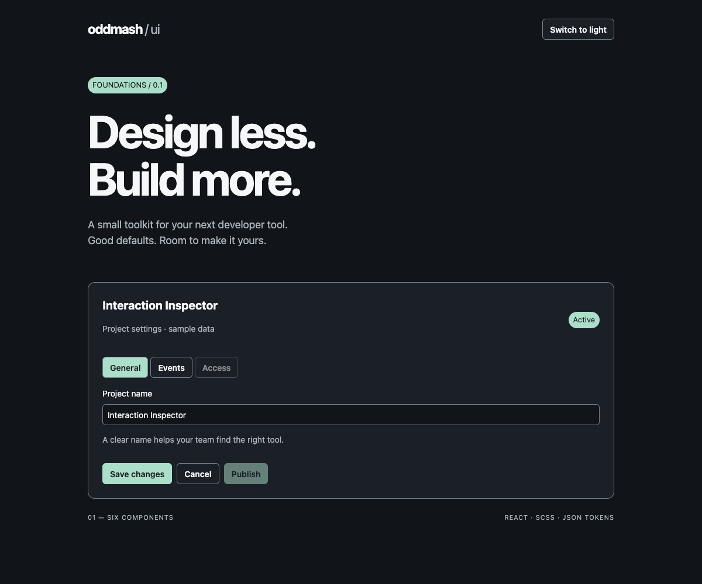

# Oddmash UI

[English](https://github.com/Oddmash/oddmash-ui#readme) · [한국어](https://github.com/Oddmash/oddmash-ui/blob/main/docs/ko/README.md) · [日本語](https://github.com/Oddmash/oddmash-ui/blob/main/docs/ja/README.md) · [简体中文](https://github.com/Oddmash/oddmash-ui/blob/main/docs/zh-CN/README.md)

Oddmash UI 为小型 React 开发者工具提供一致的默认界面。例如，使用六类组件和一次 CSS 导入即可搭建 Interaction Inspector 设置面板。**Design less. Build more.**

## 快速开始

下图展示使用示例数据的真实实现。可以在本地运行演示和 Storybook，目前没有托管演示。



```sh
git clone https://github.com/Oddmash/oddmash-ui.git
cd oddmash-ui
npm ci
npm run demo
# http://localhost:5173
npm run storybook
# http://localhost:6006
```

## 在其他项目中使用

构建需要 Node 24 或以上版本，peer 支持 React 18.3.1 和 React 19。尚未发布到 npm。先在此运行 `npm pack`，再在消费项目运行 `npm install /absolute/path/to/oddmash-ui-0.1.0.tgz`。样式只需导入一次。仅支持 ESM，不需要 Tailwind、图标包、CSS-in-JS 运行时或全局 reset。

```tsx
import { Button, Input, Card, Badge, tokens } from '@oddmash/ui';
import '@oddmash/ui/styles.css';

export const Settings = () => (
  <section data-om-theme="dark">
    <Card>
      <Badge tone="accent">Active</Badge>
      <label htmlFor="project">Project name</label>
      <Input id="project" defaultValue="Interaction Inspector" />
      <Button onClick={() => console.log('Save')}>Save changes</Button>
      <p style={{ color: tokens['color.muted'] }}>Local sample project</p>
    </Card>
  </section>
);
```

## API 与无障碍

Button 支持 `variant="primary|secondary|ghost"`、`size="sm|md"`、原生属性和 ref，默认 type 为 button。Input、Card(div)、Badge(span，`tone="neutral|accent"`) 传递原生属性、ref、className 和 style。Tabs/Dialog 保留 Radix 的受控和非受控 API。Tabs 支持方向键、Home/End 和禁用项；Dialog 支持 Escape、焦点限制和焦点返回。为 Input 提供可见 label，通过 aria-describedby 关联错误说明，并使用 aria-invalid。提供 DialogTitle/Description，避免嵌套交互元素。支持减少动态效果和强制颜色。axe 自动检查不能代替屏幕阅读器人工验证。

```tsx
import {
  Tabs, TabsList, TabsTrigger, TabsContent,
  Dialog, DialogTrigger, DialogContent, DialogTitle,
  DialogDescription, DialogClose, Button,
} from '@oddmash/ui';

export const Views = () => (
  <Tabs defaultValue="events">
    <TabsList aria-label="Inspector views">
      <TabsTrigger value="events">Events</TabsTrigger>
      <TabsTrigger value="focus">Focus</TabsTrigger>
    </TabsList>
    <TabsContent value="events">No events recorded.</TabsContent>
    <TabsContent value="focus">Select an element.</TabsContent>
  </Tabs>
);
export const SettingsDialog = () => (
  <Dialog>
    <DialogTrigger asChild><Button>Settings</Button></DialogTrigger>
    <DialogContent theme="dark">
      <DialogTitle>Settings</DialogTitle>
      <DialogDescription>Configure the local project.</DialogDescription>
      <DialogClose asChild><Button>Done</Button></DialogClose>
    </DialogContent>
  </Dialog>
);
```

## 令牌与构建选择

JSON 是唯一原始来源。Primitive 定义颜色与尺度，semantic 定义 light/dark 的用途。颜色、间距、字体、圆角、边框、阴影和动效采用 DTCG $type/$value、结构化 sRGB 颜色/尺寸以及 alias。主题使用独立文件，不依赖私有 modes 扩展。使用 Style Dictionary 5 的 DTCG 支持、引用解析和 CSS 转换，避免维护自制颜色及复合令牌转换器。它仅为开发依赖。小型 TypeScript 脚本生成 CSS 和类型化变量引用，并拒绝无效引用、主题键不一致和过期生成物。不要直接修改 src/generated 或 dist。SCSS 直接使用 CSS 变量，不维护重复值表。

```text
tokens/
  primitive.json
  semantic/light.json
  semantic/dark.json
scripts/tokens.ts
src/
  generated/tokens.css    ← generated
  generated/tokens.ts     ← generated
  button.tsx / input.tsx / card.tsx / badge.tsx
  tabs.tsx / dialog.tsx
  styles.scss
  foundations.stories.tsx
.storybook/
demo/                    ← consumes package exports
tests/                   ← behavior, hydration, tokens, browsers
.github/workflows/ci.yml
```

```json
{
  "semantic": {
    "color": {
      "accent": { "$type": "color", "$value": "{primitive.color.mint}" }
    }
  }
}
```

## 主题与覆盖

默认主题为 light。在 html 或局部区域设置 data-om-theme="light"/"dark"。系统偏好及持久化由应用负责。覆盖样式应在包 CSS 之后加载。长期维护的品牌值应存于项目 JSON 并生成 CSS（参见 Inspector 集成）。下方手写 CSS 仅为说明，并非另一份原始来源。局部定制请覆盖 semantic 令牌；primitive 和 semantic alias 表达式在各主题边界一起生成。Dialog 默认 portal 到 body，局部主题应显式传入 theme；自定义品牌需提供该区域内的 container。Shadow DOM 必须注入内部 CSS 并提供内部 portal container。封闭 Shadow DOM 内的 modal 行为不在本 MVP 验证范围内。

```scss
.my-tool {
  --om-semantic-color-accent: #087c66;
  --om-semantic-color-accent-hover: #066451;
  --om-semantic-color-on-accent: #ffffff;
  --om-semantic-radius-sm: 4px;
}
```

## 开发与贡献

CI 使用 React 18/19 及对应类型包运行类型检查、lint、测试、令牌一致性、包/Storybook/演示构建以及三浏览器测试。请执行下方命令。修改 JSON 后重新生成并一起提交生成文件，API 变更需添加行为测试。保持四种语言 README、语言链接和截图同步。遵循组织贡献政策，跨项目 API 变更先通过 issue 讨论。npm 发布需要所有者另行批准并核实 scope 权限。

| Command | Purpose |
| --- | --- |
| `npm run tokens` | JSON → CSS + TypeScript |
| `npm run tokens:check` | Reject stale generated files / theme mismatch |
| `npm run typecheck` | TypeScript |
| `npm run lint` | ESLint |
| `npm test` | Behavior, SSR/hydration, token pipeline |
| `npm run build` | ESM, declarations, CSS |
| `npm run test:bundle` | Button-only bundle <= 2 kB; no Radix |
| `npm run build-storybook` | Static component explorer |
| `npm run build:demo` | Package-consuming demo |
| `npm run check` | All non-browser checks |
| `npx playwright install chromium firefox webkit` | Browser setup |
| `npm run test:browser` | Keyboard, focus trap, axe, responsive, motion |
| `npm pack` | Local installable archive; no publishing |

## 范围与集成

v0 只包含六类组件，不包含 Select、Toast、表单框架、主题 provider 或字体下载。Inspector 通过项目 JSON 覆盖保留紧凑的深色外观并接入 Button，不改变记录、隐私或权限逻辑。集成分支和验证结果记录于 docs/VERIFICATION.md。下一步是辅助技术人工验证、确定发布负责人以及按实际需求扩展。

MIT. [Style Dictionary](https://styledictionary.com/reference/config/) · [Radix Dialog](https://www.radix-ui.com/primitives/docs/components/dialog) · [Contribution policy](https://github.com/Oddmash/.github/blob/main/CONTRIBUTING.md)
